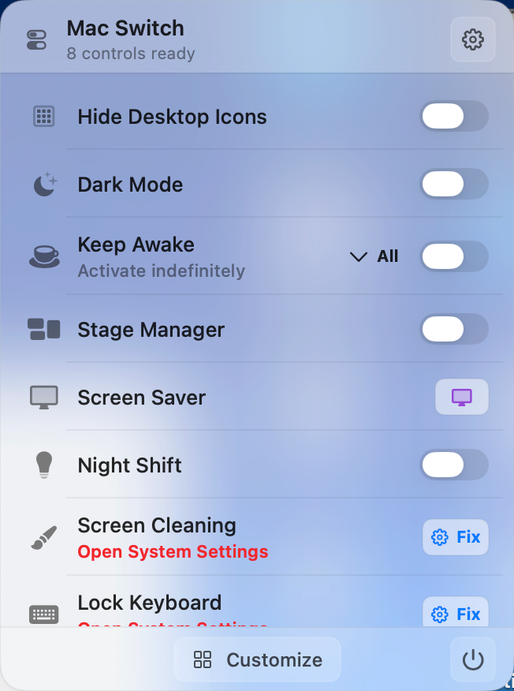
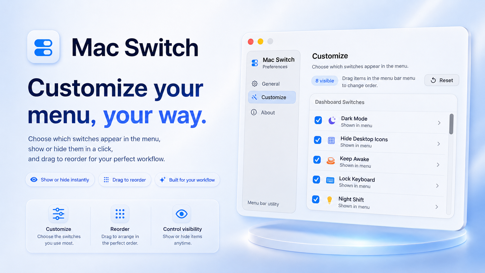

# Mac Switch

## [Download Latest Release](https://github.com/%69%54%76%58/mac-switch/releases/latest)

Download the current notarized Mac Switch build from GitHub Releases.

Mac Switch is a native macOS menu bar utility for the small system controls you reach for every day. Keep the app tucked away in the menu bar, open one compact panel, and toggle common Mac actions without digging through System Settings.

## Highlights

- Fast access to essential Mac toggles from one menu bar panel.
- Real system actions, not placeholder UI.
- Customizable dashboard visibility and drag-to-reorder menu items.
- Lightweight native SwiftUI/AppKit app built for macOS 14 and later.
- Open source under the MIT License, with permission to use, modify, and redistribute.

## Controls

Mac Switch currently includes:

| Everyday toggles | System utilities |
| --- | --- |
| Keep Awake | Screen Saver |
| Stage Manager | Display Sleep |
| Hide Widgets | Screen Resolution |
| Mute Microphone | Screen Cleaning |
| Hide Desktop Icons | Lock Keyboard |
| Dark Mode | Lock Screen |
| Bluetooth Audio | Xcode Cache Clean |
| Handoff | Empty Trash |
| Do Not Disturb | Eject Disk |
| Night Shift | Empty Pasteboard |
| True Tone, when available | Hide Windows |
| Play Music | |
| Show Hidden Files | |
| Hide Dock | |
| Low Power Mode | |
| Energy Mode | |

Software Update checks are included for official builds distributed through the app's update feed.

## Customize

Choose which switches appear in the menu, hide what you do not use, and drag visible menu items directly in the dashboard to match your workflow. Preferences include General, Customize, and About panels, with per-switch options where a control needs extra setup.

Keep Awake has a timer button directly in its dashboard row. Click it, or right-click the row, to select a duration and toggle **Keep awake when the lid is closed**. The selected duration is marked, and the same settings stay synchronized with Customize. Changing the lid option during a running session preserves its deadline; changing the duration restarts the timer with that duration. Lid-closed operation uses a bundled signed helper. Choose **Authorize Keep Awake** in Customize > Keep Awake, then approve it once in System Settings > General > Login Items & Extensions; subsequent changes do not prompt for a password. The helper restores the original sleep policy when the session ends, the app disconnects, or a timed session expires. It accepts only the signed Mac Switch app and exposes only the sleep operation.

Night Shift follows the macOS model: like Control Center, the dashboard switch makes a temporary change that lasts until the next scheduled time, and the row shows when that is, such as **On until 07:00** or **Off until sunset**. Open the clock button beside Night Shift in the menu bar (or right-click the row) to choose **Off**, **Sunset to Sunrise**, **Custom**, or **Always On**. Custom start/end times and **Keep the switch as set** are available in the same quick panel, without opening Customize. **Always On** keeps it on around the clock. Turn on **Keep the switch as set** to make the switch itself persistent, whatever the schedule; turning the option off restores your previous schedule. Modes hold Night Shift through scheduled times and restore the exact schedule they replaced. The panel also shows what last changed Night Shift, such as the macOS schedule or Control Center.

Modes save the original microphone UID, per-channel mute/volume state, and display UUID/resolution before making changes. Switching your default input or selected display does not redirect restoration. If the original device is disconnected, the Mode retains its recovery record until you reconnect it and retry. Interrupted activation or restoration is recovered on the next launch, and completed restoration steps are not repeated. Older sessions that lack device identity ask for manual device recovery in Mode settings.

If the Keep Awake helper disconnects, the menu immediately stops claiming lid-closed protection and reconnects using the session’s original deadline. Night Shift schedule changes retain their recovery data until all writes or rollback succeed; retry the last change if recovery is still pending. A temporary DND observation failure does not disable an otherwise verified setup. Unrelated switches remain responsive while another action waits for power-mode authorization.

## Permissions

Mac Switch only asks for macOS permissions needed by the features you use:

- Apple Events: Dark Mode, Play Music, Empty Trash, and fallback Lock Screen actions.
- Accessibility/Input Monitoring: Lock Keyboard and Screen Cleaning event suppression.
- Bluetooth: paired audio device listing and connection.
- Location: sunrise/sunset Dark Mode scheduling.

Do Not Disturb uses two bundled, signed Apple Shortcuts. In Customize > Do Not Disturb, install **Mac Switch DND Enable** and **Mac Switch DND Disable**, then choose **Verify Setup** once with Focus off. Verification briefly enables DND and restores it to off; subsequent actions run in the background. The helpers read Current Focus and explicitly return its name, so state checks do not depend on shared Focus Status. Opening the dashboard shows the last confirmed DND state without executing a shortcut. Toggle preflight, Mode activation, and restoration use fresh observations, including when DND was already on. Other active Focus modes are left unchanged. Reinstalling or renaming the helpers requires setup again. Legacy custom DND shortcuts are no longer used.

## Official Releases

Official downloads are published through the repository's GitHub Releases and the in-app update feed. Downstream builds use their own signing identities and update feeds. Maintainer signing credentials and private keys are not included in the source tree.

## License

Mac Switch is open source under the MIT License. Commercial use, modification, redistribution, and distribution of forked versions are permitted, provided the copyright and permission notices are retained. Third-party dependencies retain their own licenses.

See [LICENSE](LICENSE).

## Trademark Notice

Apple, Mac, macOS, Stage Manager, Night Shift, and True Tone are trademarks of Apple Inc., registered in the U.S. and other countries and regions. Mac Switch is not affiliated with or endorsed by Apple Inc.

### Local CI runner

PR builds and release builds run on the dedicated `mac-switch-local` runner.
Handoff compatibility checks exercise the installed macOS/Swift toolchain; they
no longer use the hosted macOS 14/15 matrix. The runner starts at user login.

Keep `NOTARY_PROFILE`, `NOTARY_KEYCHAIN`, `KEYCHAIN_DB`,
`KEYCHAIN_PASSWORD_FILE`, and `SPARKLE_BIN_DIR` in its private environment.
The password file unlocks the dedicated signing Keychain before preflight checks.
Sparkle retains the existing `com.maxyu.macswitch.sparkle` signing account.
A manual Release run with `validate_only` verifies the complete build and signed
update feed without publishing. Supply a tag for a normal manual release.
